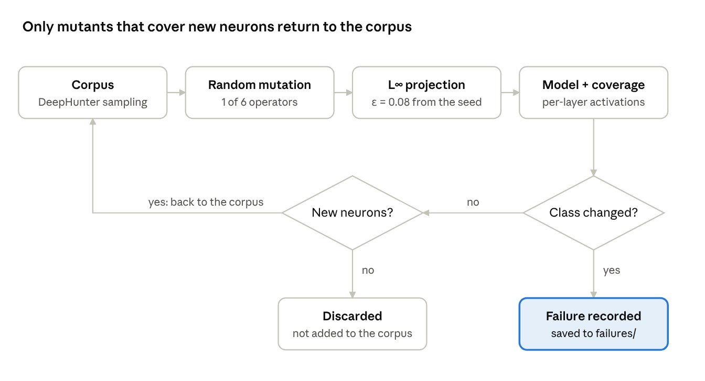
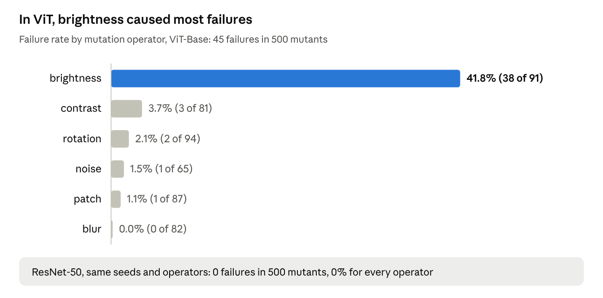

# Fuzz Testing for Machine Learning: Methods and Results

October 28, 2026 · Leonardo Rocha

> Exported from the editable version at https://claude.ai/artifact/CbXwfNptHjc4N4oXic3kb4 (private until shared).

## Abstract

We applied fuzz testing to two kinds of machine-learning components: image classifiers (ResNet-50 and ViT-Base) and the DistilBERT tokenizer. For the classifiers, we implemented a TensorFuzz-style fuzzer guided by neuron coverage, which mutates seed images within an L∞ ball of radius 0.08 and flags any change in the predicted class as a failure. For the tokenizer, we used Atheris, a coverage-guided fuzzer for Python, with four oracles, including a metamorphic round-trip property. Because the execution environment could not reach the Hugging Face Hub, both classifiers ran with randomly initialized weights and the tokenizer used a local WordPiece vocabulary. Under these conditions, the fuzzer found failures in 45 of 500 ViT mutants (9.0%) and in none of 500 ResNet mutants; brightness shifts accounted for 38 of the 45 failures. Neuron coverage saturated for ViT (94.6% from the seeds alone) and stalled for ResNet (8.2% to 9.2%), and coverage gains did not coincide with failures. The tokenizer fuzzer exposed a genuine contract violation in the pure-Python tokenizer: with `max_length = 2`, a one-character input produced three tokens. These results validate the pipeline but do not measure the robustness of the trained models.

**AI-generated content.** This report, the code it describes and the accompanying slides were produced with Claude (Anthropic) through Claude Code. See Section 7 for the full disclosure.

## 1. Introduction

Fuzz testing generates large numbers of inputs automatically and checks whether any of them causes a failure. Modern fuzzers such as libFuzzer are coverage-guided: they retain the inputs that exercise new parts of the program and mutate them further. Machine-learning systems challenge both ingredients. A neural network rarely crashes, so the **oracle** must instead detect behaviour that should not occur, such as a prediction that changes under an imperceptible perturbation. Moreover, every input executes the same code path, so **coverage** is usually redefined over neurons rather than lines of code (Pei et al., 2017; Odena et al., 2019).

This work contrasts the two settings, classical code-coverage fuzzing of a tokenizer and neuron-coverage fuzzing of image classifiers, through five research questions:

- **RQ1.** Can small, imperceptible perturbations change a classifier's predicted class?
- **RQ2.** Which mutation types cause the most failures?
- **RQ3.** Is a CNN (ResNet) more or less robust than a Transformer (ViT)?
- **RQ4.** Does increasing neuron coverage help find more failures?
- **RQ5.** Does the tokenizer behave correctly on arbitrary Unicode text?

## 2. Systems Under Test

We tested three components from the Hugging Face ecosystem. Layer and neuron counts refer to the units our fuzzer monitored.

| Component | Architecture | Purpose | Input | Monitored layers | Monitored neurons | Experiment |
| --- | --- | --- | --- | --- | --- | --- |
| [microsoft/resnet-50](https://huggingface.co/microsoft/resnet-50) | Residual CNN | Classifies the main object in a photo into one of 1,000 ImageNet classes | 224×224 image | 17 (stem + 16 bottleneck blocks) | 15,168 channels | 1 |
| [google/vit-base-patch16-224](https://huggingface.co/google/vit-base-patch16-224) | Vision Transformer, 16×16 patches | Same task and classes as ResNet-50 | 224×224 image | 12 `ViTLayer` blocks | 9,216 hidden units (12 × 768) | 1 |
| [distilbert-base-uncased](https://huggingface.co/distilbert-base-uncased) (tokenizer) | WordPiece, lower-cased | Splits text into tokens and maps them to the integer ids the model consumes | Unicode text | n/a | n/a | 2 |

ResNet-50 and ViT-Base represent the two dominant families in computer vision, convolution and attention. Because they share the input size and label set, both can be fuzzed with identical seeds and mutations. The tokenizer was chosen because every input to DistilBERT passes through it, so a defect there propagates to all downstream predictions.

## 3. Methods

### 3.1 Experimental environment and deviations

All runs used a CPU-only Linux cloud container (4 cores, 15 GB RAM).

| Component | Version |
| --- | --- |
| Python | 3.13 |
| PyTorch / torchvision | 2.14.1 / 0.29.1 |
| transformers | 5.21.0 (4.57.6 for the pure-Python tokenizer) |
| Atheris | 3.1.0 |
| pandas / matplotlib | 3.0.5 / 3.11.2 |

Three deviations from the intended protocol constrain the interpretation of the results:

1. **No access to the Hugging Face Hub.** The environment's network proxy blocked `huggingface.co`, so no pretrained weights could be downloaded. Both classifiers ran with `--random-weights`: the published architecture with weights randomly initialized from a fixed seed (0).
2. **Synthetic seeds.** Instead of photographs, we used six generated images (colour gradients with a solid rectangle). A randomly initialized model recognizes nothing, so natural photographs would not have changed this limitation.
3. **Local tokenizer vocabulary.** We replaced the DistilBERT vocabulary with a small WordPiece vocabulary of 125 tokens (special tokens, letters, digits, punctuation and a few subwords). Tokenization, truncation and decoding logic are unchanged; only the vocabulary differs.

### 3.2 Experiment 1: neuron-coverage fuzzing of image classifiers

The fuzzer (`fuzz_resnet.py`) follows the design of TensorFuzz (Odena et al., 2019) and DeepHunter (Xie et al., 2019): it mutates images, measures which neurons they activate and retains the mutants that reach previously unexplored regions of the network. Figure 1 summarizes the loop.



*Figure 1.* Each mutant ends in one of three states: it is recorded as a failure, returned to the corpus because it activated new neurons, or discarded.

**Mutation operators.** All operators act on images with pixel values in [0, 1]; parameters are sampled uniformly at each iteration.

| Operator | Effect | Sampled range |
| --- | --- | --- |
| noise | adds Gaussian noise | σ from 0.01 to 0.1 |
| brightness | adds a constant to every pixel | −0.15 to +0.15 |
| contrast | scales pixel deviations from the mean | factor from 0.7 to 1.3 |
| rotation | rotates the image | −15° to +15° |
| blur | Gaussian blur | kernel 3, 5 or 7; σ from 0.5 to 2 |
| patch | paints a solid-colour square | side from 1/16 to 1/5 of the image |

**Design decisions.**

- **L∞ projection.** After each mutation, every pixel is clipped to lie within `EPSILON = 0.08` (about 20 intensity levels out of 255) of the *original* seed, even after chained mutations. This keeps the perturbation small.
- **Neuron definition.** A neuron is one channel of a ResNet block (spatially averaged) or one hidden dimension of a ViT block (averaged over tokens).
- **Coverage criterion.** Following DeepXplore (Pei et al., 2017), activations are min-max scaled to [0, 1] within each layer for every input; a neuron counts as covered once any input has driven it above `COV_THRESHOLD = 0.5`.
- **Seed selection.** Following DeepHunter, a corpus element is drawn with probability proportional to 1 / (1 + times already selected), so new mutants are explored first.
- **Oracle.** A failure occurs when the mutant's predicted class differs from the class the model assigned to the original seed. Ground-truth labels are therefore not required.

### 3.3 Experiment 2: code-coverage fuzzing of the tokenizer

The second fuzzer (`fuzz_tokenizer_atheris.py`) uses [Atheris](https://github.com/google/atheris), a libFuzzer-based engine for Python. Atheris generates byte strings, records which lines and branches of the Python code each one executes, and retains in its corpus the inputs that increase this coverage.

**Input encoding.** The leading bytes of each input are decoded into a `max_length` between 2 and 512; the remaining bytes become a Unicode string without surrogates. The string is tokenized with truncation enabled.

**Oracles.** Any violation raises an exception, and Atheris stores the offending input as `crash-<hash>`.

1. The call must not raise an exception.
2. The number of tokens must not exceed `max_length`.
3. Every token id must lie within the vocabulary.
4. **Metamorphic round trip.** Let d1 = decode(encode(text)) and d2 = decode(encode(d1)); then d1 must equal d2. The first round may normalize the text (case, accents, whitespace), but the second must change nothing.

**Fast versus pure-Python tokenizer.** The default Hugging Face tokenizer is implemented in Rust, whose execution Atheris cannot observe. We therefore added a `FUZZ_SLOW=1` mode that loads the pure-Python tokenizer. This mode requires `transformers` 4.x, because version 5 removed the Python implementation of the BERT tokenizer.

### 3.4 Reproducibility

The code is available in the `leonardorh18/ml-fuzzy-tests` repository, branch `claude/jolly-galileo-ghok7l`. The commands below reproduce every run reported here.

```bash
pip install -r requirements.txt

# Experiment 1 (500 iterations, random weights)
python fuzz_resnet.py --random-weights --iters 500 --out results_resnet
python fuzz_resnet.py --random-weights --model google/vit-base-patch16-224 --iters 500 --out results_vit
python compare_results.py results_resnet results_vit --out comparacao.png

# Experiment 2: fast tokenizer (60 s)
mkdir -p corpus
FUZZ_TOKENIZER=./tok python fuzz_tokenizer_atheris.py corpus -max_total_time=60

# Experiment 2: pure-Python tokenizer (transformers 4.x)
pip install "transformers<5"
FUZZ_SLOW=1 FUZZ_TOKENIZER=./tok python fuzz_tokenizer_atheris.py corpus -max_total_time=90

# Replay the crash that was found
FUZZ_SLOW=1 FUZZ_TOKENIZER=./tok python fuzz_tokenizer_atheris.py crash-5c626056eddb3f9017328e0f3899da54f957c3f3
```

With access to the Hugging Face Hub, removing `--random-weights` and `FUZZ_TOKENIZER=./tok` runs the same experiments on the pretrained models; natural photographs should then be placed in `seeds/`.

## 4. Results

### 4.1 Experiment 1: ResNet-50 versus ViT-Base (random weights)

With the same six seeds, 500 iterations per model and `EPSILON = 0.08`, the fuzzer found failures in 9.0% of ViT mutants and in none of the ResNet mutants (Table 1). For both models the mean L∞ distance of the mutants was 0.079, close to the bound.

*Table 1.* Summary of the two fuzzing runs.

| Metric | ResNet-50 | ViT-Base |
| --- | --- | --- |
| Failures (of 500 mutants) | 0 | 45 (9.0%) |
| Seeds with at least one failure | 0 of 6 | 4 of 6 |
| First failure | none | iteration 20 |
| Distinct predicted classes across the 6 seeds | 1 (all `LABEL_884`) | 5 |
| Mean confidence of the predicted class | 98.4% | 0.7% |
| Initial neuron coverage | 8.2% | 94.6% |
| Final neuron coverage | 9.2% | 98.1% |
| Final corpus size (6 seeds + mutants) | 76 | 48 |
| Wall-clock time (CPU, 4 cores) | 17 s | 43 s |



*Figure 2.* Failure rate by mutation operator for ViT-Base.

The 45 ViT failures fell into eight class pairs; the most frequent, `LABEL_998 → LABEL_504`, occurred 16 times. The Pearson correlation between coverage gain and failures per 100-iteration window was −0.31 for ViT (five windows) and undefined for ResNet, which produced no failures.

### 4.2 Experiment 2: tokenizer

*Table 2.* Tokenizer fuzzing runs.

| Run | Duration | Executions | Coverage (Python edges) | Outcome |
| --- | --- | --- | --- | --- |
| Fast tokenizer (Rust), transformers 5.21 | 61 s | 258,995 | 141 | no violation |
| Pure-Python tokenizer, transformers 4.57 | < 1 s | ~470 | 295 | violation of oracle 2 |

The pure-Python tokenizer violated oracle 2: with `max_length = 2`, the one-character input `'Ƒ'` yielded three tokens, `[CLS] x [SEP]`. The tokenizer logged *"We need to remove 1 to truncate the input but the first sequence has a length 1"* and returned the sequence untruncated. On the same input, the fast tokenizer returned `[CLS] [SEP]` and respected the limit. The minimal input is 6 bytes long (`CpEBAAAA` in base64) and reproduces deterministically.

## 5. Discussion

### 5.1 Answers to the research questions

**RQ1 (small perturbations).** For ViT, yes: 9.0% of mutants within ε = 0.08 changed the predicted class. However, the randomly initialized ViT is nearly undecided; its mean confidence of 0.7% is barely above the 0.1% of a uniform guess over 1,000 classes. With such small margins between the top classes, almost any perturbation can flip the prediction. A trained model would likely have larger margins and, therefore, fewer failures.

**RQ2 (mutation types).** Brightness caused most failures (41.8% of brightness mutants). It is the only operator that spends the full perturbation budget on every pixel. Rotation and blur produce large changes in a few pixels, which the L∞ projection clips, largely undoing these mutations and explaining their near-zero failure rates.

**RQ3 (CNN versus Transformer).** These data cannot answer RQ3. With random weights, ResNet-50 collapsed into a constant classifier: all six seeds were assigned `LABEL_884` with 98.4% mean confidence. A model that always returns the same answer is trivially robust, so the absence of ResNet failures says nothing about trained CNNs.

**RQ4 (coverage and failures).** No. The seeds alone covered 94.6% of ViT neurons, leaving almost nothing for mutants to add, while ResNet coverage stalled near 9%. The negative correlation for ViT (r = −0.31) rests on only five windows and is weak evidence, but it shows no benefit from coverage. The min-max coverage criterion appears highly sensitive to the threshold and to the architecture.

**RQ5 (tokenizer robustness).** The fast tokenizer showed no violation in 258,995 executions, but Atheris could not observe its Rust code, so coverage stopped at 141 edges and the search was effectively unguided. The pure-Python tokenizer exposed twice as much coverage (295 edges) and violated oracle 2 in under one second. Although `max_length = 2` is an edge case, the behaviour breaks the tokenizer's contract: downstream code that allocates tensors of size `max_length` would fail. The divergence between the two implementations of the same tokenizer also motivates a differential oracle.

### 5.2 Threats to validity

- **Internal validity.** The classifiers used random weights and synthetic seeds, and `COV_THRESHOLD` was set to 0.5 to avoid a floor effect rather than calibrated per model.
- **External validity.** The tokenizer used a 125-token local vocabulary. Only the truncation finding, which does not depend on the vocabulary, is expected to transfer to the real DistilBERT tokenizer, and this remains unverified.
- **Statistical conclusion validity.** Each configuration ran once with a single random seed; we report no repeated trials or confidence intervals.
- **Construct validity.** The oracle compares each mutant with the model's own prediction on the seed, not with ground truth, so it detects instability rather than misclassification.

## 6. Future Work

- [ ] Repeat Experiment 1 with pretrained weights (without `--random-weights`), 5 to 20 natural photographs in `seeds/` and 2,000 iterations, on a machine with Hugging Face access.
- [ ] Calibrate `COV_THRESHOLD` per model, or replace per-input min-max scaling with per-neuron ranges calibrated on training data (as in DeepGauge), so that ViT coverage does not saturate.
- [ ] Rerun Experiment 2 with the real DistilBERT tokenizer to confirm the truncation failure.
- [ ] Add a differential oracle requiring the fast and pure-Python tokenizers to return identical ids.
- [ ] Sweep `EPSILON` over 0.02, 0.04, 0.08 and 0.16 to estimate the perturbation size at which each model starts to fail.
- [ ] Repeat each configuration with several random seeds and report confidence intervals.

## 7. AI Use Disclosure

During the preparation of this work, the author used Claude (Anthropic), through Claude Code, to implement the fuzzing code, run the experiments, draft this report, produce the slides and translate both into English. All numerical results come from the runs described in Section 3 and can be reproduced with the commands in Section 3.4. The author is responsible for reviewing the content before use; in particular, bibliographic details should be checked against the original sources.

## References

- Odena, A., Olsson, C., Andersen, D., & Goodfellow, I. (2019). TensorFuzz: Debugging neural networks with coverage-guided fuzzing. *Proceedings of the 36th International Conference on Machine Learning (ICML)*.
- Pei, K., Cao, Y., Yang, J., & Jana, S. (2017). DeepXplore: Automated whitebox testing of deep learning systems. *Proceedings of the 26th Symposium on Operating Systems Principles (SOSP)*.
- Xie, X., Ma, L., Juefei-Xu, F., et al. (2019). DeepHunter: A coverage-guided fuzz testing framework for deep neural networks. *Proceedings of the 28th ACM SIGSOFT International Symposium on Software Testing and Analysis (ISSTA)*.
- Google. Atheris: A coverage-guided Python fuzzing engine. https://github.com/google/atheris
